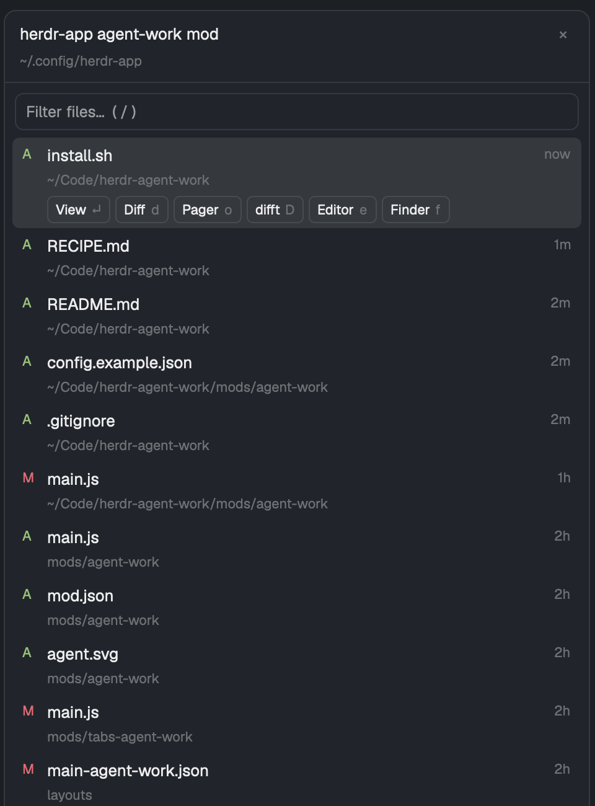

# herdr-kurtzmann

A Herdr panel that follows the focused Claude Code session and lists every file
it and its subagents wrote or edited, with a fuzzy filter, an inline preview
(rendered markdown, highlighted code) and diffs against the file as it was
before the session touched it.

Named after [Mr. Kurtzmann](https://www.youtube.com/watch?v=esSUJJmlPPI), head
of Records in Terry Gilliam's *Brazil*: the man in charge of the archive, in a
permanent panic over the smallest discrepancy in the paperwork. It also sounds
like it belongs next to `grep` and `cron`.



## Two ways to use it

**As a side panel next to Files and Changes (the layout).**

```sh
./install.sh
herdr-app do layout.switch --name main-kurtzmann
```

Click **Kurtzmann** in the tab bar. `ctrl-shift-l` switches back to your own layout.
`main-kurtzmann` and `tabs-kurtzmann` are clones of Herdr's `main` layout and
`tabs` mod (0.1.18) with a Kurtzmann block and button added; they don't receive
Herdr's later changes to those.

**As a pane, on any layout (the mod only).** `./install.sh --mod-only`, then run
"Kurtzmann: open beside this pane" from the command palette.

`install.sh` copies into `~/.config/herdr-app` (or `$HERDR_APP_HOME`), keeps
your `config.json`, and runs `herdr-app check`. Herdr loads a symlinked mod
folder but doesn't hot-reload it, so copy rather than symlink. While developing,
`./install.sh --watch` (needs `fswatch`) reinstalls on every save.

## What it reads and runs

It reads Claude Code's files under `~/.claude` (`sessions/`, `projects/`
transcripts and subagent transcripts, `file-history/` backups), runs `hc get`,
`git` (read-only queries), `python3` (transcript parsing), `sh` and `wc`, and
the viewers below. It writes nothing except temp files under `$TMPDIR` when it
reconstructs a file's original content for a diff. Local machine only.

## Keys

List: `/` filter, `j` `k` move, `↵` view, `d` diff, `o` open in pager or app,
`D` difft in a split, `e` editor, `f` reveal, `r` refresh.
Detail: `1` `2` `3` or `tab` Preview, Diff, vs HEAD; `esc` back.

## Tools

Defaults: `glow` for markdown, `jq` for JSON, `bat` (if installed) or `less -R`
for the rest, `difft` for diffs, `open` for images/PDFs and reveal (macOS),
`$VISUAL`/`$EDITOR` for editing. Override any of them by copying
`mods/kurtzmann/config.example.json` to `config.json` in the same folder.
Commands run with `sh -c`; `{file}`, `{before}`, `{after}` and `{dir}` are
passed as quoted arguments. On Linux, set `app` to `xdg-open {file}` and
`reveal` to something like `xdg-open "$(dirname {file})"`.
