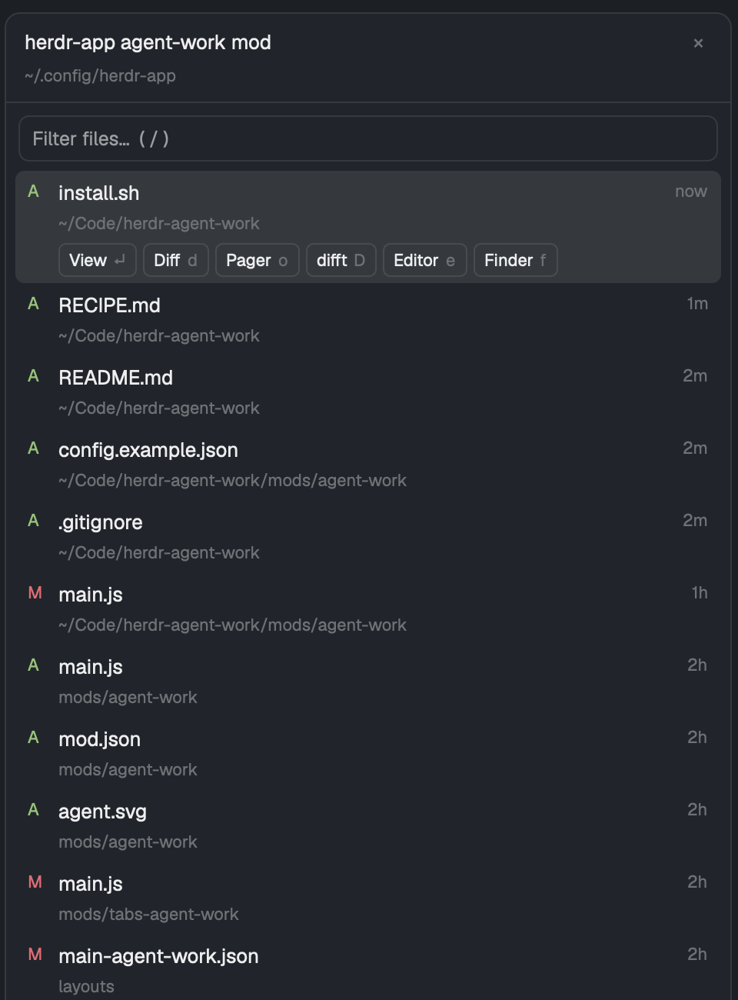

# Kurtzmann

A right-side panel, beside Herdr's Files and Changes, that follows whichever
Claude Code session runs in the focused terminal and lists every file that
session and its subagents wrote or edited. Each file can be previewed inline,
diffed against how it was before the session touched it, or opened in a pager,
diff tool, editor or the system's app, all from the keyboard.

## What you see

Layout `main-kurtzmann`: Herdr's `main` layout with one more child,
`kurtzmann`, in the right panel's stack (`panel-body`), and a tab bar
(`tabs-kurtzmann`) with a **Kurtzmann** button (sparkle icon) after Files and
Changes. The panel is 368px by default, resizable from 280 to 900px.

The panel, top to bottom, framed like Files (10px radius, theme `border`,
`background` fill):

- Header: the session's AI title (bold, wraps), a `×` that hides the panel; below
  in 11px `dim`: branch (`muted`), the session's folder (`~`-shortened, wraps),
  `↑n ↓n` against upstream, `● n` uncommitted changes in `blocked`.
- Filter field, 30px, placeholder "Filter files… ( / )", border turns `accent`
  while typing.
- The list. Files are grouped under agent headings (11px `accent`, with a count)
  when subagents edited anything: `main` first, then subagents by latest edit.
  Each file is two lines: name (13px) and folder (11px `dim`), both wrapping,
  relative to the repo top when inside it. A letter on the left: `A` new
  (`ansi2`), `M` modified (`blocked`), `D` no longer on disk (`dim`). Age on the
  right (`now`, `5m`, `2h`, `3d`). Newest first; when filtering, best match
  first, matched letters in bold `accent`.
- The selected row (`selected` background) shows buttons: View ↵, Diff d,
  Pager o (Open app for images/PDF/office/media), difft D, Editor e, Finder f.
  Buttons that can't work (file gone) are dimmed.
- Footer: the keys for the current view, 11px `dim`.

Detail view (replaces the list): back arrow, file name and folder, tabs
Preview 1 / Diff 2 / vs HEAD 3, the same action buttons, then the body:
rendered markdown (selectable, scrollable), a read-only highlighted editor
(soft wrap) for code, or a unified diff in the terminal font with `+` lines in
`ansi2` and `-` lines in `ansi1` on a 15% tint, hunk headers in `accent`.

## How it behaves

- Follows the session: on every focus change and every 5s it asks `hc get <t>
  --json` for the focused terminal's foreground pid, reads
  `~/.claude/sessions/<pid>.json` for its `sessionId`, and switches to it. When the
  focused terminal isn't Claude Code (a shell, a pager it opened, the panel
  itself) it keeps the last session. Remote terminals are ignored.
- Transcripts are read incrementally (byte offsets, complete lines only) every 5s;
  git status every 30s or when transcripts grow. Paused while the window is hidden.
- Keys in the list: `/` focus filter, `j`/`k`/arrows move, `g`/`G` top/bottom,
  `↵`/space/`l` detail, `d` detail on Diff, `o` open, `D` difft split, `e`
  editor, `f` reveal, `r` refresh, `esc` clear filter. While typing: arrows move,
  `↵` opens the top result, `esc` clears and returns to the list. In detail:
  `1` `2` `3`/`tab` switch, `esc`/`backspace`/`h`/`q` back.
- Double-click a row: detail. Click selects.
- Diff tab: the file's first backup in this session vs now. New files show whole.
  vs HEAD: `git diff HEAD -- file` in its folder.
- Opened tools appear as normal terminals right of the focused pane
  (`terminal.open place right`) and close when the program exits.

## Built from

- `layouts/main-kurtzmann.json`: `layout.clone main`; tabs block's mod set to
  `tabs-kurtzmann`; `{ "id": "kurtzmann", "type": "block", "content": { "mod":
  "kurtzmann" } }` appended to `panel-body`.
- `mods/tabs-kurtzmann`: `mod.clone tabs`, two edits: the enabled panel list
  gets `"kurtzmann"` appended (so the per-space panel memory restores it), and a
  `panelButton("kurtzmann", "Kurtzmann", "mods/kurtzmann/kurtzmann.svg")` after Changes.
- `mods/kurtzmann/main.js`: one `View`. Herdr functions: `focused`, `panes`,
  `exec`, `hc`, `home`, `appHome`, `readTextFile`, `run`, `theme`, `settings`,
  `window`, `checking`, `nextCommand`, `props`, `closeOverlay`. Commands:
  `terminal.open`, `layout.hide`, `pane.close`. gpui-base: `InputState`/`Input`
  (filter), `TextView.markdown`, `EditorState`/`Editor`, `ScrollHandle`.
- Session data: `~/.claude/projects/*/<id>.jsonl` and
  `~/.claude/projects/*/<id>/subagents/agent-*.jsonl` (+ `.meta.json` for the
  subagent's `name`/`agentType`). An inline `python3 -I -c` script parses only new
  bytes and keeps: `ai-title` records (`aiTitle`); `user` records whose
  `toolUseResult` has `filePath` and `structuredPatch` (successful Write/Edit;
  `type: "create"` marks a new file); `file-history-snapshot`
  (`snapshot.trackedFileBackups`) and `file-history-delta` (`trackingPath`,
  `backup`) records. A backup's path is `trackingPath` if absolute, else
  `realParentDir` + its base name; the lowest `version` per path is the
  pre-session state, `backupFileName: null` meaning it didn't exist; the file is
  `~/.claude/file-history/<id>/<backupFileName>`.
- Inline diff: `git diff --no-index --no-color -U3 -- <before> <after>` (exit 1 =
  differences).
- `mod.json` palette entry: `pane.split {direction: right, mod: kurtzmann, props:
  {standalone: true}}`, so the mod works without the layout.
- `config.json` (optional, beside main.js) overrides the tool commands; see
  `config.example.json`. Commands run via `sh -c` with placeholders turned into
  positional arguments.

## Watch out

- Subagent transcripts have no file-history records; their edits get a backup only
  when the main session's snapshots track the same file. Otherwise the diff falls
  back to the first edit result's `originalFile` (often null), then to nothing:
  use vs HEAD.
- Don't match transcript lines by `"name":"Write"` text: `api-request-shape`
  records contain the tool schemas. Filter on record `type`.
- `hc get` gives the shell's pid as `pid`; the Claude process is
  `foreground.pid`.
- A symlinked mod folder loads but does not hot-reload; install by copying.
- macOS defaults (`open`, `open -R`); set `app`/`reveal` in config.json elsewhere.
- GUI editors in `$EDITOR` (`code --wait`) run without `--wait` outside a
  terminal; anything else opens in a split.
- Lists up to everything one session edited (no cap); previews cap at 400 KB,
  inline diffs at 4000 lines.
- Clones are of Herdr 0.1.18's `main` and `tabs`.

## Done when

- With a Claude Code session focused, the panel's title is that session's AI title
  and the list shows the files it wrote, `A` for created ones.
- Focusing another Claude Code pane switches the list; focusing a shell doesn't
  clear it.
- A subagent's edits appear under its name.
- Typing in the filter narrows the list with highlighted letters; `↵` opens the
  top match's preview.
- A markdown file's Preview is rendered; `o` opens `glow -p` in a split.
- A file the session modified shows only the session's changes on Diff; a file it
  created shows whole as additions.
- `D` opens difft in a split; `q` closes it.
- `herdr-app check mods/kurtzmann` and `mods/tabs-kurtzmann` pass.
